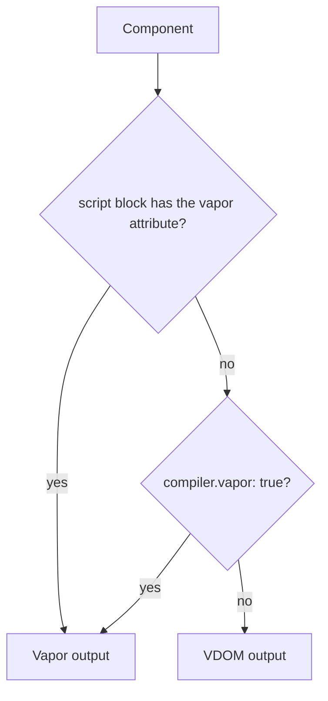

# Vapor Mode

[Vapor Mode](https://blog.vuejs.org/posts/vue-vapor) is Vue's compilation mode without a virtual DOM:
templates compile to code that creates and updates DOM nodes directly. Vize has its own Vapor
compiler, so the same Vite plugin, CLI, linter, and inspector handle Vapor components.

> [!WARNING]
> Vapor Mode needs Vue 3.6 or newer and is experimental in both Vue and Vize. Start with a few
> components, compare them in the [Playground](https://vizejs.dev/play), and keep VDOM for the rest.

## Which components compile to Vapor



JSX and TSX components follow `jsxMode` and the `"use vue:vapor"` directive instead; see
[JSX and TSX](#jsx-and-tsx).

## One component at a time

Add the `vapor` attribute to the component's script block. Nothing else changes:

```vue
<script setup vapor>
import { ref } from "vue";

const count = ref(0);
</script>

<template>
  <button @click="count++">Clicked {{ count }} times</button>
</template>
```

This is the safest way to start, because every other component keeps its current output. Mounting
Vapor components inside a VDOM app uses Vue's runtime APIs (such as `vaporInteropPlugin`); see the
[Vapor announcement](https://blog.vuejs.org/posts/vue-vapor) for the runtime side.

## The whole project

Compile every SFC to Vapor from `vite.config.ts`:

```ts
import { defineConfig } from "@vizejs/vite-plugin/vite-plus";

export default defineConfig({
  compiler: { vapor: true },
});
```

With the plain Vite plugin, pass the option directly:

```ts
import { defineConfig } from "vite";
import vize from "@vizejs/vite-plugin";

export default defineConfig({
  plugins: [vize({ vapor: true })],
});
```

In Nuxt, set `vize.compiler.vapor` in `nuxt.config.ts`; see the [Nuxt integration](../integrations/nuxt.md).

| Setting                                  | Scope                       | Notes                                          |
| ---------------------------------------- | --------------------------- | ---------------------------------------------- |
| `<script vapor>` / `<script setup vapor>` | One SFC                     | Always wins for that file                      |
| `compiler.vapor` / `vize({ vapor })`     | Every SFC in the project    | Stable switch; `false` is an explicit opt-out  |
| `experimentals.vapor`                    | Every SFC, as an experiment | Ignored when `compiler.vapor` is set; see [Experimentals](./experimentals.md#vapor) |

## JSX and TSX

`.jsx` and `.tsx` components choose their output with `compiler.jsxMode` (`"vdom"` by default) or a
directive at the top of the component:

```tsx
const Fast = () => {
  "use vue:vapor";
  return <div class="fast" />;
};
```

[JSX and TSX: output mode](./jsx.md#output-mode-vdom-vs-vapor) covers the precedence rules.

## Inspect the output

Compare Vize's Vapor output with Vue's compiler for one file, either in the
[Playground](https://vizejs.dev/play) or from the terminal:

```bash
vize build --vapor src/components/Counter.vue
vize inspector src/components/Counter.vue --target vapor
```

## Lint for Vapor

Some APIs do not exist or behave differently in Vapor components, such as the Options API,
`getCurrentInstance()`, and `@vue:` lifecycle events. The [Vapor rules](../rules/vapor.md) catch
them before runtime. Rules such as `vapor/no-vue-lifecycle-events` are in the default preset.

## Current limits

- Vapor output follows Vue 3.6's runtime; components need a Vue version that ships Vapor.
- For JSX and TSX, keeping module-level imports and exports intact in Vapor output is still
  incomplete; see [JSX and TSX](./jsx.md).
- When Vize's output differs from Vue's, the official compiler is the reference. Please
  [report the difference](./testing.md) with an inspector link.
