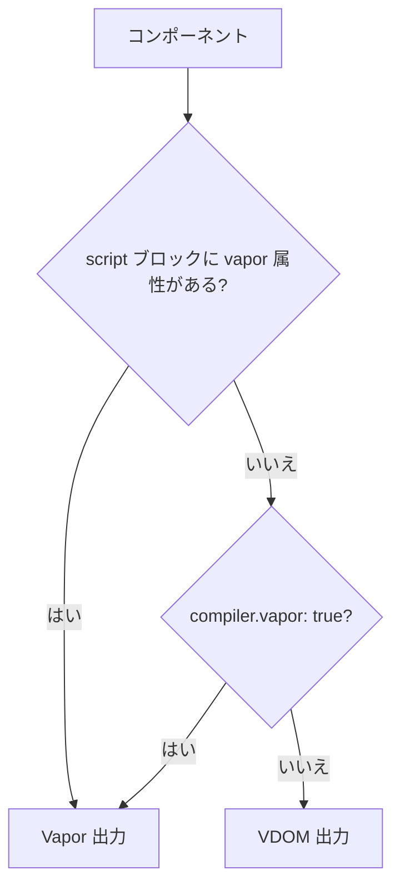

# Vapor モード

[Vapor モード](https://blog.vuejs.org/posts/vue-vapor)は、仮想 DOM を使わない Vue のコンパイル方式です。
テンプレートは、DOM ノードを直接作成・更新するコードにコンパイルされます。Vize は独自の Vapor
コンパイラーを持っているため、Vapor コンポーネントも同じ Vite プラグイン、CLI、linter、インスペクター
で扱えます。

> [!WARNING]
> Vapor モードには Vue 3.6 以降が必要で、Vue と Vize の両方で実験的な機能です。少数のコンポーネント
> から始め、[Playground](https://vizejs.dev/play) で出力を比べ、それ以外は VDOM のままにしてください。

## どのコンポーネントが Vapor になるか



JSX と TSX のコンポーネントは、代わりに `jsxMode` と `"use vue:vapor"` ディレクティブに従います。
[JSX と TSX](#jsx-と-tsx) を参照してください。

## コンポーネント単位で試す

コンポーネントの script ブロックに `vapor` 属性を付けます。それ以外の変更は不要です。

```vue
<script setup vapor>
import { ref } from "vue";

const count = ref(0);
</script>

<template>
  <button @click="count++">Clicked {{ count }} times</button>
</template>
```

他のコンポーネントの出力は変わらないため、最も安全な始め方です。VDOM のアプリに Vapor コンポーネントを
マウントするには Vue のランタイム API（`vaporInteropPlugin` など）を使います。ランタイム側は
[Vapor の紹介記事](https://blog.vuejs.org/posts/vue-vapor)を参照してください。

## プロジェクト全体

`vite.config.ts` で、すべての SFC を Vapor でコンパイルします。

```ts
import { defineConfig } from "@vizejs/vite-plugin/vite-plus";

export default defineConfig({
  compiler: { vapor: true },
});
```

通常の Vite プラグインでは、オプションを直接渡します。

```ts
import { defineConfig } from "vite";
import vize from "@vizejs/vite-plugin";

export default defineConfig({
  plugins: [vize({ vapor: true })],
});
```

Nuxt では `nuxt.config.ts` の `vize.compiler.vapor` を設定します。[Nuxt 連携](../integrations/nuxt.md)を
参照してください。

| 設定                                      | 範囲                         | 補足                                           |
| ----------------------------------------- | ---------------------------- | ---------------------------------------------- |
| `<script vapor>` / `<script setup vapor>` | 1 つの SFC                   | そのファイルでは常に優先される                 |
| `compiler.vapor` / `vize({ vapor })`      | プロジェクトのすべての SFC   | 安定した設定。`false` で明示的に無効にできる   |
| `experimentals.vapor`                     | すべての SFC（実験として）   | `compiler.vapor` がある場合は無視される。[Experimentals](./experimentals.md#vapor) を参照 |

## JSX と TSX

`.jsx` と `.tsx` のコンポーネントは、`compiler.jsxMode`（デフォルトは `"vdom"`）か、コンポーネント
先頭のディレクティブで出力を選びます。

```tsx
const Fast = () => {
  "use vue:vapor";
  return <div class="fast" />;
};
```

優先順位は [JSX と TSX: 出力モード](./jsx.md#出力モード-vdom-と-vapor)を参照してください。

## 出力を確認する

1 つのファイルについて、Vize の Vapor 出力と Vue のコンパイラーの出力を、
[Playground](https://vizejs.dev/play) またはターミナルで比べられます。

```bash
vize build --vapor src/components/Counter.vue
vize inspector src/components/Counter.vue --target vapor
```

## Vapor 向けの lint

Options API、`getCurrentInstance()`、`@vue:` のライフサイクルイベントなど、Vapor コンポーネントでは
存在しない、または動作が異なる API があります。[Vapor のルール](../rules/vapor.md)は、それらを実行前に
検出します。`vapor/no-vue-lifecycle-events` などはデフォルトのプリセットに含まれています。

## 現在の制限

- Vapor の出力は Vue 3.6 のランタイムに従います。Vapor を含む Vue のバージョンが必要です。
- JSX と TSX では、Vapor 出力でモジュールレベルの import と export をそのまま保つ処理がまだ完全では
  ありません。[JSX と TSX](./jsx.md) を参照してください。
- Vize の出力が Vue と異なる場合は、公式コンパイラーが基準です。インスペクターのリンクを添えて
  [違いを報告](./testing.md)してください。
