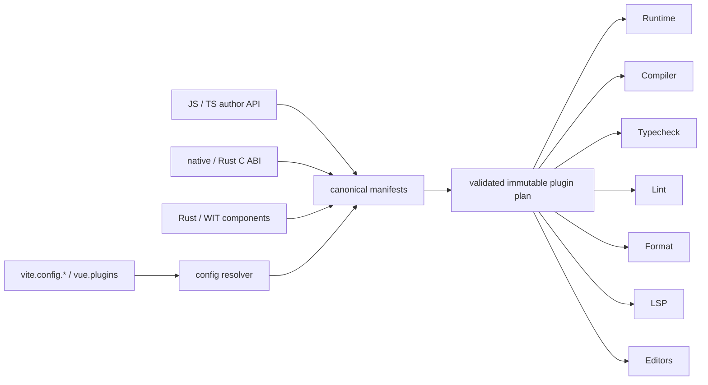

# Integrated plugin API draft

> [!WARNING]
> This document is a design draft, not a supported API. It does not change the
> v1 scope. V2 incubates the first experimental surface; the stable guest ABI
> and Davinci host remain v3 work tracked in [#13074](https://github.com/ubugeeei-prod/vize/issues/13074).

Vize should let one plugin extend Vue runtime behavior and every tool that
understands the same source. Authors should not need separate Vite, compiler,
TypeScript, lint, format, language-server, and editor plugins for one feature.

The project configuration remains the single source of truth:

```ts
// vite.config.ts
import { defineConfig } from "vite-plus";
import { nativePlugin } from "@vizejs/plugin-sdk";
import { designSystem } from "@acme/vize-plugin-design-system";
import { routes } from "@acme/vize-plugin-routes";

export default defineConfig({
  // Ordinary Vite plugins remain here.
}).withVue({
  plugins: [
    designSystem({ strict: true }),
    routes({ block: "route" }),
    nativePlugin("@acme/vize-plugin-policy", { profile: "strict" }),
  ],
});
```

The [delivery order](./integrated-plugin-priority-experiences.md) starts with
custom lint, directive and block DX, and a project-wide Vue Router integration;
compiler macros, custom format, and declarative `app.use` follow. Every slice
still uses this one resolved plan across all Vize products.

## Goals

- Configure a feature once and obtain matching runtime, compiler, type,
  diagnostic, formatting, navigation, completion, and HMR behavior.
- Support TypeScript/JavaScript authors and Rust authors without copying a
  private Vize AST or depending on Rust's unstable dynamic-library ABI.
- Keep the no-plugin path byte-identical and measurement-equivalent.
- Prefer declarative contributions that Vize can compile into native tables.
  Batch the remaining callbacks and attribute their cost to the owning plugin.
- Preserve authored UTF-8 ranges, source maps, diagnostic identity, edit
  ordering, and behavior across VDOM, Vapor, SSR, and hydration.
- Run under Node and Bun, on every supported host, without unmanaged temporary
  files.

## Non-goals

- Changing the existing plugin API v1 or adding this work to the v1 release
  gate.
- ESLint, Prettier, Babel, or Volar API compatibility.
- Loading arbitrary Rust `cdylib` files into the Vize process.
- Allowing plugins to mutate private compiler arenas or replace core LSP
  responses without a negotiated capability.
- Treating a JavaScript worker as a security boundary.

## Existing foundation

This proposal unifies shipped pieces instead of introducing a parallel stack:

- `npm/plugin-sdk` already defines deterministic lint rules, fact providers,
  bounded native transforms, formatter/output hooks, visitor descriptors,
  fingerprints, and sandbox contracts.
- `crates/vize_vitrine/src/napi/plugin_sdk*` already batches selected native
  facts and attributes cache/callback costs.
- the SFC parser, native/Wasm bindings, formatter, linter, type checker, and LSP
  already preserve custom-block ranges; `route`, `i18n`, and `art` have useful
  but separately wired product integrations;
- macro artifacts and custom blocks already cross the compiler/bundler result;
  and
- Vite+ already projects the canonical `vue` section of `vite.config.*` into
  compiler, type-check, lint, format, and editor tasks.

The missing layer is a production host that resolves these surfaces into one
versioned plan and makes every product consume it. Existing public behavior and
specialized integrations are compatibility oracles for that migration.

The [custom-block companion](./integrated-plugin-custom-block-api-draft.md)
records the current split, first-class document contract, exact mapping and
ownership rules, and behavior-preserving migration gates.

## One manifest, one execution plan

Every authoring helper lowers to a versioned, canonical manifest. The host
validates all manifests and builds one immutable directed acyclic graph before
processing source files.



```ts
import { defineVizePlugin } from "@vizejs/plugin-sdk";

export default defineVizePlugin({
  apiVersion: 2,
  stability: "experimental",
  name: "@acme/vize-plugin-design-system",
  version: "0.1.0",
  supports: {
    vue: ["3"],
    outputs: ["vdom", "vapor", "ssr"],
    runtimes: ["node", "bun"],
  },
  permissions: [],
  cacheInputs: [],
  setup(api, options: { strict: boolean }) {
    api.runtime.module("design-system", {
      entry: "@acme/design-system/vize-runtime",
    });
    api.vue.global("$theme", {
      runtime: api.import("@acme/design-system/runtime", "theme"),
      type: api.importType("@acme/design-system", "ThemeService"),
    });
    api.vue.directive("track", {
      runtime: api.import("@acme/design-system/runtime", "vTrack"),
      value: api.importType("@acme/design-system", "TrackPayload"),
      modifiers: { once: { optional: true, default: false } },
    });
  },
});
```

`setup` runs once while resolving config. It may register contributions but
does not receive source files. Most contributions become native lookup tables;
only explicitly declared callback capabilities keep a guest alive.

The canonical manifest includes:

- API version, plugin identity, package integrity, export name, and normalized
  JSON options;
- supported Vue/output/runtime/host ranges;
- capabilities, permissions, ordering edges, and exclusive ownership claims;
- declared config, environment, file, and dependency inputs;
- callback runtime and entrypoint identity; and
- every virtual module, virtual document, diagnostic, edit, and cache schema
  version produced by the plugin.

Unknown capabilities, cycles, duplicate exclusive owners, missing callbacks,
unsupported hosts, and undeclared inputs fail before compilation. Ordering is a
stable topological order, not package discovery order. Plugins use `before` and
`after` edges; authored config order is the final stable tie-break. Numeric
priority is intentionally absent.

## Native and JavaScript backends

Parcel's native plugin design is a useful reference: its
[package manifest](https://github.com/parcel-bundler/parcel/blob/634ef6c9fb90ec9bfb512111fa92fce666d1d2ef/crates/parcel-plugin-abi/src/manifest.rs)
selects platform artifact packages, its
[loader](https://github.com/parcel-bundler/parcel/blob/634ef6c9fb90ec9bfb512111fa92fce666d1d2ef/crates/parcel/src/plugin_factory.rs)
presents native and JavaScript plugins through common traits, and its
[C ABI](https://github.com/parcel-bundler/parcel/blob/634ef6c9fb90ec9bfb512111fa92fce666d1d2ef/crates/parcel-plugin-abi/plugin.h)
evolves through size-prefixed append-only tables. Vize should adopt those
principles, not Parcel API compatibility.

One capability contract can have these implementations:

- `native`: an in-process shared library using the stable Vize C ABI. Rust is
  the primary SDK, while the ABI does not require a Rust compiler ABI;
- `js`: the same semantic contract implemented through
  `@vizejs/plugin-sdk`, usable from Node and Bun; and
- `wasm`: an optional WIT/component implementation for portability and stronger
  capability isolation when its latency is acceptable.

```json
{
  "name": "@acme/vize-plugin-policy",
  "engines": { "vize": "^2.0.0-0" },
  "vize": {
    "api": 2,
    "stability": "experimental",
    "nativeAbi": 1,
    "artifacts": {
      "aarch64-apple-darwin": "@acme/vize-plugin-policy-darwin-arm64",
      "x86_64-unknown-linux-gnu": "@acme/vize-plugin-policy-linux-x64-gnu"
    },
    "js": "./dist/plugin.js",
    "wasm": "./dist/plugin.wasm"
  }
}
```

The metadata package pins platform packages as optional dependencies; each
artifact package declares its OS, CPU, libc, library path, checksum, and
provenance. A development-only library path may point at a local build but is
removed from published manifests.

Backend choice is observable and reproducible:

```ts
nativePlugin("@acme/vize-plugin-policy", {
  backend: "native", // "js" | "wasm" | an explicitly admitted "auto"
  profile: "strict",
});
```

`native` never silently falls back to `js` when an artifact is missing or its
ABI is incompatible. `auto` is allowed only when the package declares semantic
equivalence and all implementations pass the same conformance corpus; the
chosen backend is part of the plan, diagnostics, cache key, lock receipt, and
performance report. CI must exercise every published backend, not only the
preferred one.

The native ABI uses an API version plus size-prefixed host tables, argument
records, and result records. Compatible changes append fields or symbols. The
host validates package engine range, ABI, target triple, artifact integrity,
required functions, thread-safety declaration, and capability manifest before
calling plugin code. Handles have call-scoped lifetimes unless the ABI states
otherwise. Host-owned allocation, diagnostics, files, source maps, cancellation,
and logging cross explicit function tables rather than private Rust types.

## Contract versioning

The repository already publishes plugin API v1 (`BATCH_SCHEMA = 1` and
`VISITOR_API_VERSION = 1`). This proposal does not rename or retroactively widen
that contract.

- API v1 keeps its current lint/fact/transform/output/visitor behavior and is
  hosted through a compatibility adapter.
- API v2 is this experimental integrated manifest. V1 plugins cannot claim new
  capabilities such as custom-block ownership.
- API v3 is the eventual stable surface after v2 qualification and the complete
  Davinci host. Promotion alone does not require changing an unchanged wire
  schema.

API generation, transport wire version, native ABI, WIT package version, and
individual capability schema versions are separate axes. Negotiation happens
before payloads or callbacks:

```ts
interface PluginHandshake {
  wireVersion: 1;
  supportedApiVersions: readonly number[];
  capabilities: readonly {
    id: string;
    schemaVersions: readonly number[];
    required: boolean;
  }[];
}
```

An unknown required capability or unsupported schema refuses the plugin. New
optional capabilities and appended size-prefixed fields are additive; changed
semantics, required fields, variants, function signatures, or ownership rules
are breaking. JSON, TypeScript, Rust, C, and WIT surfaces share pairwise
compatibility fixtures in Actions.

## Capability families

### Runtime modules and injection

A plugin declares virtual modules and typed installation points instead of
concatenating arbitrary strings into generated code.

```ts
api.runtime.install({
  id: "analytics",
  module: api.import("@acme/analytics", "install"),
  phase: "app:before-mount",
  targets: ["client", "ssr"],
});
```

The compiler emits stable imports and calls at a small set of public phases.
Each contribution declares client/SSR behavior, serialization requirements,
side effects, and HMR disposition. VDOM, Vapor, and SSR either consume the same
contribution or the host refuses the plugin for that output.

### Vue globals beginning with `$`

`api.vue.global` owns runtime installation and type projection together. The
runtime side installs the value on `app.config.globalProperties`; the type side
adds the same name to component instance and template contexts. LSP completion,
hover, definition, rename policy, and diagnostics use that exact declaration.

Conflicting names fail. A server-only or client-only value must expose that
availability in its type and diagnostics. A plugin cannot publish a type without
the matching runtime contribution unless it explicitly declares a type-only
global.

### Custom directives

`api.vue.directive` declares one directive contract:

- runtime import and optional compile-time lowering;
- value, argument, modifier, element, and component types;
- VDOM, Vapor, and SSR support or an explicit refusal;
- static/dynamic argument rules and modifier completion;
- lint rules, hover text, definition target, and code actions; and
- source-map ownership for compiler-generated code.

Static imports replace repeated `resolveDirective` work when the contract allows
it. Runtime-only directives keep Vue's normal resolution behavior.

### Custom blocks

Custom blocks use an independently negotiated `sfc.custom-block` capability.
One provider exclusively owns a block type and optional language; read-only
observers can consume public facts. The shared immutable artifact drives parse,
lint, format, typecheck, runtime, HMR, LSP, editors, dependencies, and exact
source maps without re-parsing.

The complete [custom-block API draft](./integrated-plugin-custom-block-api-draft.md)
specifies inline and external sources, structured runtime output, bounded HMR,
UTF-8/UTF-16 mapping, edit ownership, zero-work empty paths, and the differential
migration of `art`, `route`, and `i18n`. V1 warnings and unclaimed raw-module
behavior remain unchanged until a provider passes those gates.

### Compiler macros and preprocessors

The [compiler-macro API draft](./integrated-plugin-compiler-macro-api-draft.md)
defines binding-aware recognition, public candidate IR, structured expansion,
runtime artifacts, type and Content Mapper projections, LSP, HMR, exact maps,
and batched JavaScript/Rust authoring without exposing a mutable private AST.

Preprocessors declare an input language, output language, dependencies,
diagnostics, and a complete source map. Template, script, style, and custom-block
preprocessors use the same contract. The host rejects missing maps when a result
feeds type checking, diagnostics, formatting, or editor navigation.

### Lint and format

Custom lint is a first-class `lint.rule` capability. The complete
[custom-lint API draft](./integrated-plugin-lint-api-draft.md) defines rules,
facts, type-aware queries, diagnostics, fixes, native/JS batches, caches, cost
attribution, LSP code actions, and Node/Bun conformance. API v1 remains behind
an output-identical adapter.

Custom formatters return non-overlapping edits against an authored document or
custom block. The host reparses and validates semantic preservation before
accepting an edit set. Lint fixes and formatter edits share one conflict planner,
so their ordering is observable and deterministic.

### Type checker

Plugins contribute imports, globals, directive contracts, virtual documents,
and mappings. They never post-filter unrelated TypeScript diagnostics. Every
diagnostic retains its code, message, source, severity, related information,
and authored range through the mapping layer.

The same plugin plan is projected into ordinary checking, Content Mapper,
incremental checking, library/declaration output, and editor checking. A host
that cannot negotiate a required type capability refuses the plugin instead of
silently dropping it.

### LSP and editor behavior

The language host exposes bounded, cancellable providers inspired by the useful
parts of language-service plugin systems without adopting another project's API:

- diagnostics, completion, completion resolve, hover, signature help;
- definition, type definition, implementation, references, rename;
- document/workspace symbols, semantic tokens, inlay hints;
- code actions, code lenses, links, colors, folding, and selection ranges; and
- virtual-document inspection and plugin-specific commands.

Providers return additions or namespaced replacements under an explicit merge
policy. Core results remain unless the plugin owns the relevant document or
capability. Requests carry cancellation and document version; late responses
are discarded. Packaged editors discover the same server capabilities and need
no plugin-specific extension code for ordinary providers.

## JavaScript, native, and Rust authoring

TypeScript/JavaScript plugins use `@vizejs/plugin-sdk`. Declarative manifests
run identically under Node and Bun. Trusted callbacks run in one persistent
sidecar per workspace and cross the boundary once per batch, never once per AST
node. An optional isolated mode uses an explicit sandbox; a worker alone is not
advertised as isolation.

Rust authors use a `vize-plugin` crate. Its native target exports the stable C
entrypoints and size-prefixed records, not Rust-layout symbols. This is the
lowest-overhead trusted path: the host loads one platform library, shares
host-owned buffers through the ABI, and can call thread-safe hooks in parallel.
The same C ABI can gain Go, Swift, C, or Zig SDKs without changing the capability
model.

The Rust SDK may also target the versioned WIT/component contract. Vize hosts
that component with declared WASI capabilities and bounded memory, fuel, time,
and message sizes. Native, Wasm, and JS plugins must lower to the same manifest
and pass the same semantic conformance suite; a backend cannot define another
plugin API.

```rust
use vize_plugin::prelude::*;

#[derive(Default)]
struct Routes;

#[vize_plugin(api = 2, stability = "experimental", backend = "native")]
impl Plugin for Routes {
    fn manifest() -> Manifest {
        Manifest::new("com.acme.routes", env!("CARGO_PKG_VERSION"))
            .custom_block(CustomBlock::new("route").language("json"))
    }
}
```

## Performance and cache contract

The resolved plan is immutable and shared by compiler, lint, typecheck, format,
and LSP sessions. Empty plans take the existing entrypoints and allocate no
per-file plugin state. Non-empty plans pre-index capabilities by stage, block,
directive, macro, and language.

Cache keys include exact source bytes, Vize/native build, API/schema versions,
plugin package integrity, canonical options, declared inputs, dependency
content, target, and the preceding pipeline output. Cache hits execute no guest
callback. Persistent entries live under the owned project cache, use bounded
atomic writes, reject symlinks and invalid ownership, and never use a shared
temporary directory.

Required measurements for every implementation PR:

- exact output and complete diagnostic-packet identity with no plugins;
- cold/warm wall, CPU, peak RSS, allocation, filesystem writes, and IPC bytes;
- no-plugin p50/p95 within the existing product budget, with a target of at
  most 1% overhead and no new files;
- callback count and bytes proving at most one crossing per admitted batch;
- attributed cost and cache hit/miss counts for every plugin; and
- real projects on Node and Bun, including VDOM, Vapor, SSR, and LSP workloads.

Regressions are not waived by aggregate speedups. Results and raw sample counts
belong in the PR description.

## Security and reproducibility

`vite.config.*`, ordinary JS callbacks, and native shared libraries are trusted
project code. Permissions for filesystem roots, environment keys, subprocesses,
and network access are declared and inspectable. Native plugins are in-process
and can violate the declaration; this is never presented as isolation. Wasm
guests receive nothing beyond negotiated capabilities. Secrets, host
environment, and network are unavailable by default to isolated guests.

`vize plugin inspect --json` should print the canonical plan, ordering, package
integrities, permissions, cache inputs, ownership, unsupported targets, and cost
receipts. Release and CI modes may require an exact plugin lock receipt. The lock
never overrides config and stale locks fail closed.

## Rollout

### Phase 0 — contract and no-op host

- Add the manifest, canonical serializer, plan builder, inspector, and config
  projection from `vite.config.*` ([status](./integrated-plugin-incubation.md)).
- Prove byte-identical behavior and measured no-plugin overhead across every v1
  product before enabling a contribution.

### Phase 1 — integrated vertical slices

- Deliver `$` globals and custom directives through runtime, compiler,
  typechecker, LSP, and editor.
- Deliver one custom block through parse, lint, format, typecheck, runtime, HMR,
  and editor behavior. `route` is the preferred real-project witness.
- Host existing plugin-SDK lint/fact/format capabilities from the same plan.

### Phase 2 — extensible compilation and language tooling

- Add macros and mapped preprocessors.
- Add the complete language-provider set and custom formatter languages.
- Qualify Nuxt, Vite, Vite+, Node, Bun, supported Vue versions, and packaged
  editors with exact installed consumers.

### Phase 3 — native/Rust guests and stable ecosystem

- Publish the C ABI, Rust native SDK, Rust/WIT SDK, platform artifact workflow,
  and shared conformance kit.
- Validate at least one independently maintained JS plugin and one Rust plugin.
- Stabilize only after compatibility classification, migration tooling,
  security review, performance history, and public registry consumers pass.

## Acceptance

- One config and one plugin package produce matching behavior in Vite, Vite+,
  Nuxt, CLI, compiler, type checker, lint, format, LSP, and packaged editors.
- A real plugin exercises runtime injection, a typed `$` global, a directive,
  a custom block, lint, format, typecheck, navigation, HMR, and source maps.
- Node and Bun results are byte-identical where the contract is runtime-neutral.
- JS and Rust implementations pass the same versioned conformance fixtures.
- Disabled and empty-plugin behavior is byte-identical and performance-neutral.
- All ownership conflicts, unsupported hosts, stale plans, nondeterminism,
  malformed maps, and undeclared inputs fail closed with authored diagnostics.
- No implementation relies on unmanaged temporary files.
